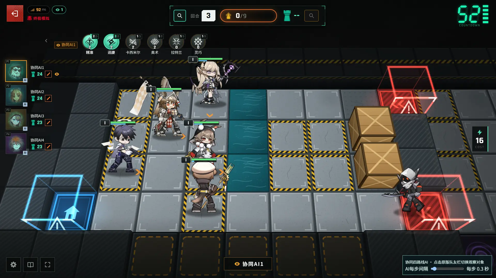

# Stronghold Protocol: coordinated teammate AI

[中文说明](README.md) · [Releases](https://github.com/Cinder325/stronghold-protocol-state-machine/releases) · [Code map](docs/CODEMAP.md)

An unofficial, non-commercial teammate addon for [Stronghold-Protocol](https://github.com/sganggs/Stronghold-Protocol).
Up to four state-machine AIs coordinate **Laterano, Kjerag, Sargon and Siracusa** without duplicating their main route.
They use confirmed native actions and bounded rehearsal searches. No neural-network weights or extra npm dependencies are included.



Actual gameplay from an isolated anonymous test on original host 0.3.1 with the public addon. The native teammate list switches viewpoints. This preview does not demonstrate a full-game win or promise a win rate.

## Quick start — no Git commands needed

1. Install **Node.js 22+** and set up a working, supported original simulator following its own instructions. Tested host packages: [0.3.3 source ZIP](https://github.com/sganggs/Stronghold-Protocol/archive/f07b8965061bbc311ad7aa815879b09264a1e47d.zip) or [0.3.1 source ZIP](https://github.com/sganggs/Stronghold-Protocol/archive/b3deebdae4a92642c007d217a1a4573e5d3612c5.zip).
2. Download and extract the [addon release](https://github.com/Cinder325/stronghold-protocol-state-machine/releases/latest). Close the game server.
3. On Windows, double-click **`install.cmd`**, paste or drag the game folder into the prompt, review the dry-run plan and confirm. On other systems, run `node scripts/setup.mjs` from this addon's folder.

Restart the simulator and refresh the browser. Add a **协同四路线AI** teammate in a cooperative room. Multiple instances receive different routes. The optional four-AI test makes the host a native spectator; the operation interval can be set to 0–5 seconds. Optional bond protection is off by default and remembers the chosen bonds without changing native ban counts.

For removal, close the server and run **`uninstall.cmd`**, or `node scripts/setup.mjs --action uninstall`. Uninstall the old revision before installing an updated revision, including updates that retain version 0.1.0.

The installer checks the host version, file hashes and unique patch anchors. These are safety checks, not a requirement to understand or manipulate Git commits. Unknown versions and locally edited integration files are intentionally refused. The original command-line installer remains available:

```sh
node scripts/install.mjs --target ../Stronghold-Protocol --dry-run
node scripts/install.mjs --target ../Stronghold-Protocol
```

## Development and limitations

See the bilingual [policy code map](docs/CODEMAP.md), [design](docs/DESIGN.md), [reproduction guide](docs/REPRODUCING.md) and [contribution guide](CONTRIBUTING.md).
The Kjerag and Sargon policies are separated into model, procurement, roster, equipment, formation and preparation modules. Shared helpers have descriptive filenames; historical exported function names stay compatible.

The [Chinese README](README.md#十局最高难度验证) retains the original ten-game snapshot and its limitations. Those results describe a pinned historical build, selected legal bans and a small sample; they are not a current general win-rate guarantee. This maintenance update does not expand long-term performance evaluation or change strategy decisions.

The addon includes teammate policies, a native observer test and reproducibility tools. It excludes the simulator, standalone game assets, audio, saves, training traces, private player automation and recording/replay features. The one gameplay screenshot is a presentation preview only.

## Credits and licence

Thanks to **[sganggs/Stronghold-Protocol](https://github.com/sganggs/Stronghold-Protocol)** for the simulator and **[HankDUMPLINGZhong/Stronghold-Protocol-AI](https://github.com/HankDUMPLINGZhong/Stronghold-Protocol-AI)** for the Arturia and Lavinia strategies and state-machine ideas.

Source and project documentation: **GPL-3.0-or-later**. See [LICENSE](LICENSE), [NOTICE](NOTICE.md), [third-party notices](THIRD-PARTY-NOTICES.md) and [source provenance](provenance.json). Game imagery and character rights remain with their respective holders; the preview grants no standalone asset licence. This fan addon is not affiliated with the original game's rights holders.
