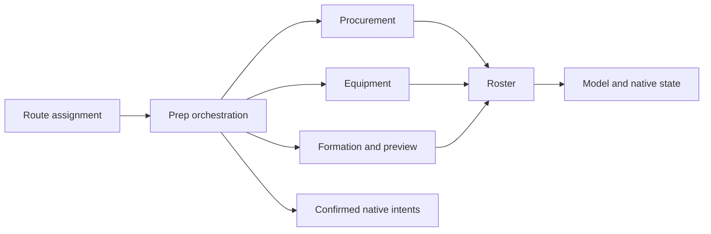

# 策略代码导航 / Policy code map

公共策略入口保持 `runtime/server/match/routeAI/policies/kjerag.mjs` 和 `sargon.mjs`，只重导出既有API。实现按职责分入同名目录；本次只移动声明和修正导入路径，未更改采购权重、动作顺序、随机数或模拟预算。

| 要调整的问题 / Concern | 谢拉格 Kjerag | 萨尔贡 Sargon |
| --- | --- | --- |
| 状态机流程、就绪收尾 / Prep orchestration | `policies/kjerag/prep.mjs` | `policies/sargon/prep.mjs` |
| 干员标识、参数、基础判定 / Model and settings | `policies/kjerag/model.mjs` | `policies/sargon/model.mjs` |
| 阵容与核心出售保护 / Roster and protected sales | `policies/kjerag/roster.mjs`、`procurement.mjs` | `policies/sargon/roster.mjs` |
| 获取收益、投资人 / Acquisition and economy | `policies/kjerag/economy.mjs` | `policies/sargon/procurement.mjs` |
| 买牌、升本、资金 / Procurement and upgrades | `policies/kjerag/procurement.mjs` | `policies/sargon/procurement.mjs` |
| 装备、转职 / Equipment and conversion | `policies/kjerag/equipment.mjs` | `policies/sargon/equipment.mjs` |
| 路径、朝向、治疗、Boss / Formation and preview | `policies/kjerag/formation.mjs` | `policies/sargon/formation.mjs` |
| 临时溢出 / Overflow protection | `policies/kjerag/overflow.mjs` | `support/roster-restoration.mjs`、`purchase-capacity.mjs` |

## 边界与来源

- `routes.js`：四路线不重复分配与策略选择；不是某一路线的采购规则。
- `driver.js`、`worker.js`、`transport.js`：队友身份、确认状态、操作间隔和Worker生命周期。修改策略通常不需要碰这些边界。
- `policies/`：本项目维护的谢拉格、萨尔贡；拉特兰与叙拉古的供应商策略通过 `engine.js` 接入。
- `support/`：跨路线可复用的容量、预演、治疗、Boss和资金工具。不要仅因工具以前带“kjerag”就复制一份给另一条路线。
- `vendor/arturia/`、`vendor/lavinia/`：两套第三方策略及其所需支持模块、许可证和固定来源记录；185个文件不代表185套独立AI。更新供应商代码时保持来源分离，不为清理命名而改写其原始清单。
- `addon-manifest.json` 是安装载荷与校验哈希；`provenance.json` 分别记录原始来源和当前分发字节；自有接入文件独立列于 `projectFiles`。改动载荷时必须同时更新。

## 历史名称映射

数字后缀来自本地开发批次，**不是宿主版本或当前策略版本**。公开导出名（如 `runKjeragPrep47`、`runSargonPrep58`）继续兼容；新实现文件和自有支持文件使用职责名。旧报告出现的文件可按下表查找。

| 旧文件 / Previous | 新文件 / Current (`support/`) |
| --- | --- |
| `cashFinish102.js` | `cash-finish.js` |
| `eliteBoss72.js` | `elite-boss-repair.js` |
| `kjerag-boss57.mjs` | `boss-planning.mjs` |
| `kjerag-bounty47.mjs` | `bounty-selection.mjs` |
| `kjerag-formation57.mjs` | `healing-coverage.mjs` |
| `kjerag-opening47.mjs` | `kjerag-opening.mjs` |
| `kjerag-placement100.mjs` | `kjerag-placement.mjs` |
| `kjerag-prep48.mjs` | `kjerag-preparation.mjs` |
| `kjerag-preview48.mjs` | `wave-preview.mjs` |
| `kjerag-projection56.mjs` | `promotion-projection.mjs` |
| `kjerag-reserve47.mjs` | `shop-reservation.mjs` |
| `kjerag-room103.mjs` | `purchase-capacity.mjs` |
| `kjerag-roster47.mjs` | `tactical-roster.mjs` |
| `kjerag-search52.mjs` | `wave-search.mjs` |
| `roster-restoration100.mjs` | `roster-restoration.mjs` |
| `sargon-mechanics58.mjs` | `sargon-mechanics.mjs` |
| `sargon-synergy73.mjs` | `sargon-synergy.mjs` |

## 本次验证范围

移动前后的69个顶层声明正文逐字节核对一致，原始公开导出保留。模块依赖、安装清单和来源哈希随拆分更新。另对固定对局作等价比较，并运行现有两版宿主集成/Worker回归；这些是重构正确性检查，不产生新的十局胜率结论。CI的长期策略评估范围保持原样。
